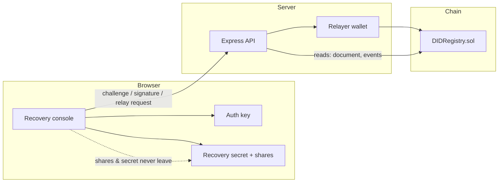
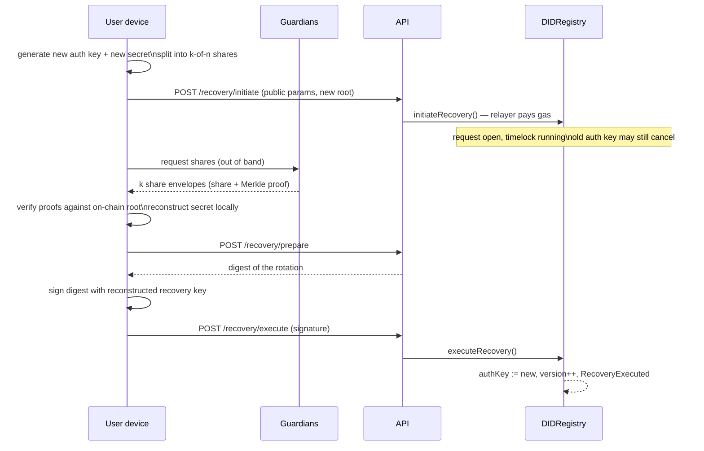

# SSS / DID — decentralized account recovery

Prototype for **IF4035 Blockchain, Semester 1 2026/2027 — area Digital Identity**.

> Implementasi Pemulihan Akun Terdesentralisasi pada Sistem Autentikasi Lintas Platform
> Menggunakan Shamir's Secret Sharing

A user holds one DID. Login is a signed challenge, not a password. The signing key can be
lost without losing the identity: a **separate recovery secret** is split with Shamir's
Secret Sharing across guardians, and any `k` of `n` shares reconstruct it **on the user's
device**. The chain stores only public keys, a Merkle root of the share commitments and an
audit trail — never a share or a secret.

## What actually works

- **Identity registration** — auth key generated in the browser, registration digest signed
  locally, transaction relayed by the server (the user needs no gas).
- **Cross-platform login** — the same DID authenticates against two simulated apps. Each
  challenge is single-use, expiring, and bound to app id + chain + registry address
  (EIP-712), so a signature for one app fails in the other.
- **Share distribution** — `k`-of-`n` split over the secp256k1 scalar field, one Merkle
  proof per share, downloadable envelope per guardian.
- **Recovery** — permissionless request + timelock, local reconstruction from `k` shares,
  possession proof by signing with the reconstructed recovery key, key rotation on-chain,
  old key rejected afterwards.
- **Audit** — every registration, request, cancellation, execution and rotation is read
  back from contract events.

Everything above is exercised by tests and by an end-to-end script against a real EVM node.

## Screens

| Identity | Authentication |
| --- | --- |
|  |  |

| Recovery result | Audit trail |
| --- | --- |
|  |  |

## Quickstart

Requirements: Node 20+, npm 10+. No Docker needed for the demo (Hardhat EVM is used).

```bash
npm install

# terminal 1 — local chain
npm run chain

# terminal 2 — deploy the registry (60s timelock)
cd packages/contracts
RECOVERY_DELAY_SECONDS=60 npx hardhat run scripts/deploy.ts --network localhost
# prints {"address":"0x…"} and writes deployments/localhost.json
cd ../..

# terminal 3 — API (port 8788)
CONTRACT_ADDRESS=0x… npm run dev:backend

# terminal 4 — console
npm run dev:web        # http://127.0.0.1:5173
```

One-shot scripted version (starts its own chain, deploys, runs the whole story, exits):

```bash
npm run demo
```

## Tests

```bash
npm test
```

| Package | Tests | What they cover |
| --- | --- | --- |
| `@sss/crypto` | 11 | split/combine, k−1 insufficiency, tampered shares, commitments, DID helpers |
| `@sss/contracts` | 12 | signed registration, rotation, timelock, replay, wrong signer, cancellation |
| `@sss/backend` | 15 | challenge/response, app binding, expiry, single use, logout, recovery wiring |
| e2e (`npm run demo`) | 10 steps | register → 2 logins → loss → reconstruct → rotate → old key dead → audit |

## Architecture



The server never sees a private key, a share, or the recovery secret. It issues challenges,
verifies signatures against the on-chain auth key, and submits signed transactions.

### Recovery flow



### Contract data model

| Field | Size | Why |
| --- | --- | --- |
| `authKey` | 20 B | verifies logins on every app |
| `recoveryKey` | 20 B | address derived from the recovery secret |
| `shareRoot` | 32 B | Merkle root of share commitments |
| `threshold`, `shareCount` | 2 B | committed share policy |
| `version`, timestamps, active | ~13 B | rotation and lifecycle |

Shares and secrets are never written on-chain. A share is proven against `shareRoot` by the
client before it is used.

## API

| Method | Path | Purpose |
| --- | --- | --- |
| `GET` | `/api/health` | chain, registry, relayer, apps, TTLs |
| `POST` | `/api/identity/prepare` | digest the device must sign to register |
| `POST` | `/api/identity/register` | relay a signed registration |
| `GET` | `/api/did/:did` | resolve document + pending request |
| `POST` | `/api/auth/challenge` | issue a one-shot EIP-712 challenge |
| `POST` | `/api/auth/verify` | verify signature, issue session |
| `GET` | `/api/auth/session` | check a session against the current key |
| `POST` | `/api/recovery/initiate` | open a recovery request |
| `POST` | `/api/recovery/prepare` | digest for the rotation signature |
| `POST` | `/api/recovery/execute` | relay the rotation |
| `POST` | `/api/recovery/cancel/prepare` | digest for cancellation |
| `POST` | `/api/recovery/cancel` | relay the cancellation |
| `GET` | `/api/audit/:did` | decoded on-chain events |

Sessions live in memory: the prototype is single-instance by design.

## Measured (local machine, Hardhat EVM)

| Operation | 2-of-3 | 3-of-5 | 4-of-7 |
| --- | --- | --- | --- |
| split | 0.012 ms | 0.011 ms | 0.018 ms |
| reconstruct (combine) | 0.044 ms | 0.284 ms | 0.542 ms |
| commitment root | 0.077 ms | 0.119 ms | 0.152 ms |
| proof verify / share | 0.033 ms | 0.045 ms | 0.045 ms |

Login round trip measured in the UI against the local API: **~60–190 ms** (target: 3 s
excluding chain confirmation). `npm run bench -w @sss/crypto` reproduces the table.
These are local numbers, not a public-network benchmark.

## Mapping to the specification

Full FR/NFR matrix with implementation evidence: [`docs/evaluation.md`](docs/evaluation.md).
Design rationale and trade-offs: [`docs/decisions.md`](docs/decisions.md). Detailed
architecture and threat model: [`docs/architecture.md`](docs/architecture.md).

Highlights:

- **FR-01..FR-10** identity, keys, DID resolution, login, signature verification,
  cross-platform use, rejection of invalid/expired/replayed auth, logout (session drop).
- **FR-11..FR-20** separate recovery secret, SSS split, share distribution, recovery
  request, local reconstruction, proof of possession, rotation, revocation of the old key,
  cross-app consistency, on-chain audit.
- **NFR-01..NFR-20** no plaintext secrets server-side or on-chain, client-side operations,
  one-shot nonces, domain binding, threshold enforcement, sub-second client crypto,
  minimal on-chain data, single-execution guard, clear errors, audit trail.

## Not in this prototype

- Guardian transport and encryption (shares are downloaded as files / kept in localStorage
  so the demo can run; production needs per-guardian encryption and delivery).
- Persistent database, rate limiting, multi-instance sessions, monitoring.
- Independent smart-contract audit; the contract is intentionally small but unaudited.
- W3C DID document serialisation and a universal resolver — `did:sss` is a prototype method.
- Share refresh on a schedule, social consensus, or guardian revocation.
- Besu provisioning: not included. The contract is plain EVM and portable, but only the Hardhat
  EVM path is provisioned and tested; current Besu releases removed `--network=dev`, so a local
  QBFT genesis is left as deployment work rather than shipped broken.

## Repository layout

```
packages/crypto      Shamir, commitments, DID helpers, share envelopes (+ bench)
packages/contracts   DIDRegistry.sol, Hardhat tests, deploy script
packages/backend     Express API, chain adapter, auth service, e2e demo
apps/web             React console (identity, auth, recovery, audit)
docs/                architecture, decisions, evaluation
scripts/demo.sh      boot chain → deploy → run e2e
```

## License

Course prototype. Contract and code are MIT-licensed for review purposes.
