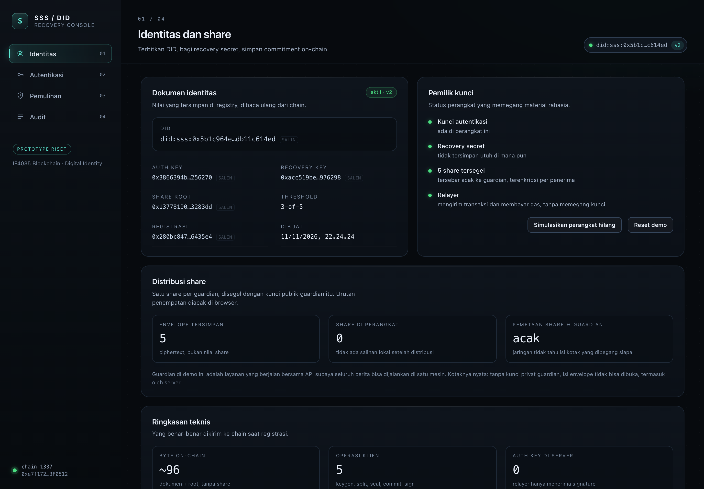
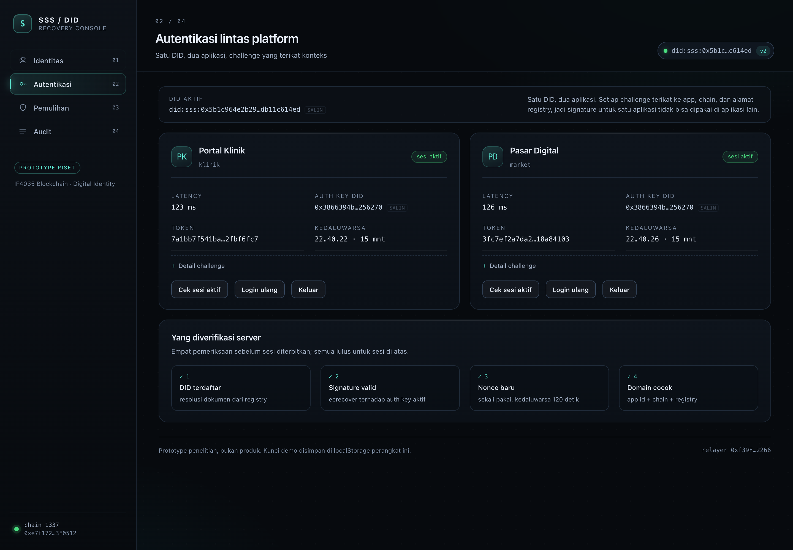
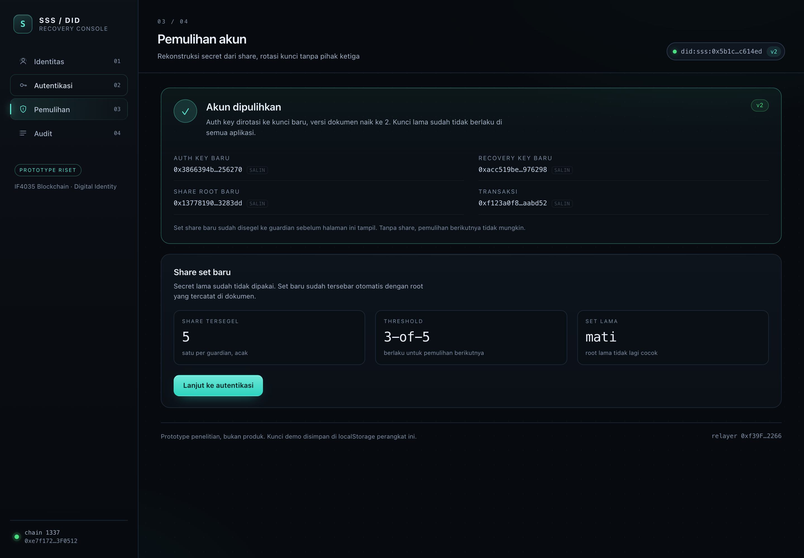
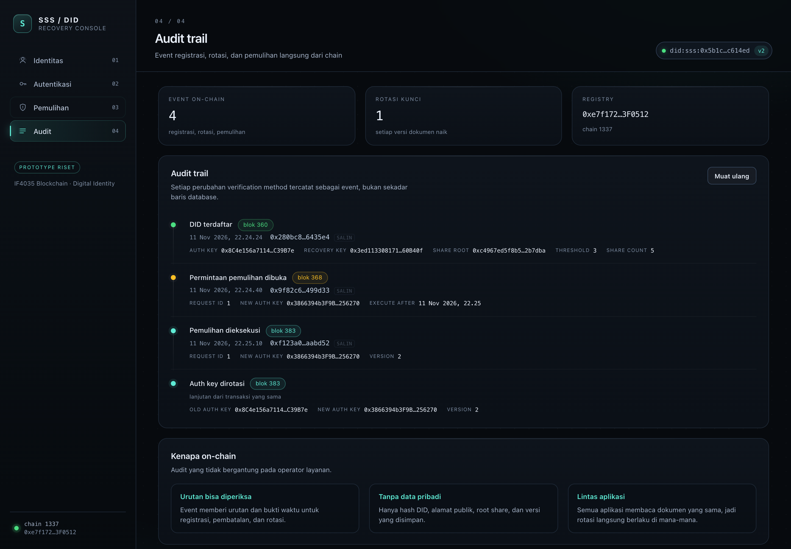

# SSS / DID — decentralized account recovery

Prototype for **IF4035 Blockchain, Semester 1 2026/2027 — area Digital Identity**.

> Implementasi Pemulihan Akun Terdesentralisasi pada Sistem Autentikasi Lintas Platform
> Menggunakan Shamir's Secret Sharing

A user holds one DID. Login is a signed challenge, not a password. The signing key can be
lost without losing the identity: a **separate recovery secret** is split with Shamir's
Secret Sharing across guardians, sealed per guardian, and any `k` of `n` shares reconstruct
it **on the user's device**. The chain stores only public keys, a Merkle root of the share
commitments and an audit trail — never a share or a secret.

## Stack (matches the specification)

| Layer | Specification | Implementation |
| --- | --- | --- |
| Blockchain | Hyperledger Besu, PoA, private network | **QBFT, 4 validators**, `chainId 1337`, 2 s blocks (`infra/besu`) |
| Smart contract | Solidity | `DIDRegistry.sol`, Solidity 0.8.24, no external calls |
| Backend | Go or Python (TBD) | **Python 3.12 / FastAPI**, `services/api` |
| Frontend | ReactJS | React 19 + Vite, `apps/web` |
| Off-chain database | PostgreSQL | sessions, challenges, sealed share mailboxes, relay locks |
| Deployment | Docker | `docker-compose.yml` (4 Besu nodes, Postgres, API, nginx console) |

## What actually works

- **Identity registration** — auth key generated in the browser, registration digest signed
  locally, transaction relayed by the server (the user needs no gas).
- **Cross-platform login** — the same DID authenticates against two simulated apps. Each
  challenge is single-use, expiring and bound to app id + chain + registry address
  (EIP-712), so a signature for one app fails in the other.
- **Randomised share distribution** — `k`-of-`n` split over the secp256k1 scalar field, one
  envelope per guardian, each sealed with X25519 + HKDF-SHA256 + ChaCha20-Poly1305. The
  device shuffles the assignment, sends only ciphertext, and keeps no share afterwards.
- **Recovery** — permissionless request + timelock, the network picks `k` guardians at
  random and rewraps their shares to an ephemeral key of the recovering device, which
  verifies every Merkle proof, reconstructs the secret locally, proves possession by
  signing, and rotates the key on-chain. The old key stops working immediately.
- **Audit** — every registration, request, cancellation, execution and rotation is read
  back from contract events.

Everything above is exercised by tests and by an end-to-end script against the real Besu
network, not a Hardhat in-process chain.

## Screens

| Identity | Authentication |
| --- | --- |
|  |  |

| Recovery result | Audit trail |
| --- | --- |
|  |  |

## Quickstart

Requirements: Docker, Node 20+, [uv](https://docs.astral.sh/uv/).

```bash
scripts/stack.sh boot        # QBFT network + Postgres + deploy + API + console
open http://127.0.0.1:8080   # console (nginx, proxies /api to the API container)
scripts/stack.sh demo        # 10-step end-to-end story against the running API
```

`stack.sh` is the only entry point you need:

| Command | Effect |
| --- | --- |
| `boot` | start 4 Besu validators + Postgres, deploy the registry, run API and console in Docker |
| `dev` | start network + database only, then run API/web from source |
| `deploy` | (re)deploy the registry on the running network and write `.env` |
| `demo` | run `services/api/scripts/e2e_demo.py` against `API_URL` (default `:8788`) |
| `test` | 11 crypto tests, 12 contract tests, 34 API tests |
| `down` / `reset` | stop containers / stop and wipe volumes and generated keys |
| `generate` | regenerate validator keys + genesis (rotates the network identity) |

Running from source instead of Docker:

```bash
scripts/stack.sh dev
cd services/api && uv sync && CONTRACT_ADDRESS=$(sed -n 's/^CONTRACT_ADDRESS=//p' ../../.env) uv run python -m app.main
npm run dev:web              # http://127.0.0.1:5173, proxies /api to :8788
```

## The chain

`infra/besu/config/qbft-config.json` is the input for Besu's own
`operator generate-blockchain-config`, so the genesis (including the QBFT `extraData`
validator list) is produced by the client rather than hand-assembled. The generated
`networkFiles/` directory is committed: four node keys, four validator addresses, genesis.

| Property | Value |
| --- | --- |
| Consensus | QBFT, 4 validators, tolerates 1 faulty node |
| chainId / networkId | 1337 |
| Block period | 2 s |
| Timelock (`recoveryDelay`) | 20 s in the demo, constructor argument |
| Relayer | Hardhat account #0, funded in the genesis alloc |
| Keys | demo fixtures only — never use them on a reachable network |

Regenerating the network (`scripts/stack.sh generate`) changes the validator set, the
genesis file and the bootnode enodes in `docker-compose.yml` together; existing volumes
become unreadable, so run `scripts/stack.sh reset` first.

## Tests

```bash
scripts/stack.sh test
```

| Suite | Tests | What it covers |
| --- | --- | --- |
| `@sss/crypto` (vitest) | 11 | split/combine, k−1 insufficiency, tampered shares, commitments, DID helpers |
| `@sss/contracts` (hardhat) | 12 | signed registration, rotation, timelock, replay, wrong signer, cancellation |
| `services/api` (pytest + PostgreSQL) | 34 | SSS, sealing, HTTP contract, challenge/app binding, expiry, replay, recovery wiring, guardian deposit/collect rules |
| e2e (`scripts/stack.sh demo`) | 10 steps | register → distribute → 2 logins → cross-app rejection → loss → 3-of-5 rewrap → rotate → old key dead → audit |

The API suite needs the database: `docker compose up -d postgres` (part of `stack.sh boot`).

## API

| Method | Path | Purpose |
| --- | --- | --- |
| `GET` | `/api/health` | chain, registry, relayer, apps, TTLs |
| `GET` | `/api/guardians` | guardian ids, labels and X25519 public keys |
| `POST` | `/api/identity/prepare` | digest the device must sign to register |
| `POST` | `/api/identity/register` | relay a signed registration |
| `GET` | `/api/did/:did` | resolve document + pending recovery |
| `POST` | `/api/shares/deposit` | store one sealed envelope per guardian |
| `GET` | `/api/shares/:did` | how many sealed envelopes are stored for a DID |
| `POST` | `/api/recovery/shares` | k random guardians rewrap their share to the device key |
| `POST` | `/api/auth/challenge` | issue a one-shot EIP-712 challenge |
| `POST` | `/api/auth/verify` | verify signature, issue session |
| `GET` | `/api/auth/session` | check a session against the current key |
| `POST` | `/api/auth/logout` | drop the session |
| `POST` | `/api/recovery/initiate` | open a recovery request |
| `POST` | `/api/recovery/prepare` | digest for the rotation signature |
| `POST` | `/api/recovery/execute` | relay the rotation |
| `POST` | `/api/recovery/cancel/prepare` | digest for cancellation |
| `POST` | `/api/recovery/cancel` | relay the cancellation |
| `GET` | `/api/audit/:did` | decoded on-chain events |

Errors are always `{error, code}`; contract rejections surface as `400 contract_rejected`.

## Data model

On chain (`DIDRegistry.sol`):

| Field | Size | Why |
| --- | --- | --- |
| `authKey` | 20 B | verifies logins on every app |
| `recoveryKey` | 20 B | address derived from the recovery secret |
| `shareRoot` | 32 B | Merkle root of share commitments |
| `threshold`, `shareCount` | 2 B | committed share policy |
| `version`, timestamps, active | ~13 B | rotation and lifecycle |

Off chain (PostgreSQL, `services/api/migrations/0001_init.sql`):

| Table | Purpose |
| --- | --- |
| `guardians` | demo guardian services: label, X25519 keypair |
| `guardian_envelopes` | sealed share ciphertext per (DID, guardian) — opaque to the server |
| `challenges` | single-use EIP-712 challenges with expiry |
| `sessions` | bearer sessions, so a second API instance agrees |
| `share_requests` | audit of which guardians served a recovery request |
| `relay_locks` | one relayer transaction per DID across API instances |

## Measured (local machine, Besu QBFT + PostgreSQL)

Client crypto, 500 iterations (`npm run bench -w @sss/crypto`):

| Operation | 2-of-3 | 3-of-5 | 4-of-7 |
| --- | --- | --- | --- |
| split | 0.009 ms | 0.009 ms | 0.013 ms |
| reconstruct (combine) | 0.033 ms | 0.219 ms | 0.424 ms |
| commitment root | 0.058 ms | 0.093 ms | 0.115 ms |
| proof verify / share | 0.024 ms | 0.035 ms | 0.035 ms |

On chain: register 123,712 gas · initiateRecovery 144,145 gas · executeRecovery 69,224 gas.
Login round trip measured in the e2e run: **~30 ms** on the local network (target 3 s,
excluding chain confirmation — authentication never waits for a transaction).

## Mapping to the specification

Full FR/NFR matrix with implementation evidence: [`docs/evaluation.md`](docs/evaluation.md).
Design rationale: [`docs/decisions.md`](docs/decisions.md). Architecture and threat model:
[`docs/architecture.md`](docs/architecture.md).

- **FR-01..FR-10** identity, keys, DID resolution, login, signature verification,
  cross-platform use, rejection of invalid/expired/replayed auth, logout.
- **FR-11..FR-20** separate recovery secret, SSS split, sealed distribution to guardians,
  recovery request, local reconstruction, proof of possession, rotation, revocation of the
  old key, cross-app consistency, on-chain audit.
- **NFR-01..NFR-20** no plaintext secrets server-side or on-chain, client-side operations,
  one-shot nonces, domain binding, threshold enforcement, sub-second client crypto,
  minimal on-chain data, single-execution guard, clear errors, audit trail.

## Not in this prototype

- **Guardian transport is simulated in-process.** Guardians run next to the API so the whole
  story is reproducible on one machine. Envelopes are genuinely sealed (the server cannot
  open them), but real deployment needs a guardian service per holder with its own key store
  and delivery channel.
- **No independent smart-contract audit.** The contract is small and unaudited; OWASP
  mitigations applied are listed in `docs/evaluation.md`.
- **TLS is not terminated by the API.** The nginx container can front it; the demo runs HTTP
  on localhost, so NFR-05 stays partial.
- **W3C DID document serialisation and a universal resolver** — `did:sss` is a prototype
  method; resolution is a single `eth_call`.
- **Rate limiting, monitoring, share refresh, guardian revocation, social consensus** — out of
  scope for one semester prototype.
- **No retry queue for relayer outages** (NFR-15 partial): the client can retry, and the
  `relay_locks` table prevents duplicate recovery transactions.

## Repository layout

```
infra/besu/               QBFT genesis config, generated validator keys, network files
packages/crypto           Shamir, commitments, DID helpers, share envelopes (+ bench)
packages/contracts        DIDRegistry.sol, Hardhat tests, deploy script (network: besu)
services/api              Python FastAPI backend, PostgreSQL migrations, pytest suite
services/api/demo_client  device-side reference client used by tests and the e2e demo
apps/web                  React console (identity, auth, recovery, audit) + nginx image
scripts/stack.sh          the only entry point: boot, dev, deploy, demo, test, reset
docs/                     architecture, decisions, evaluation
```

## License

Course prototype. Contract and code are MIT-licensed for review purposes.
