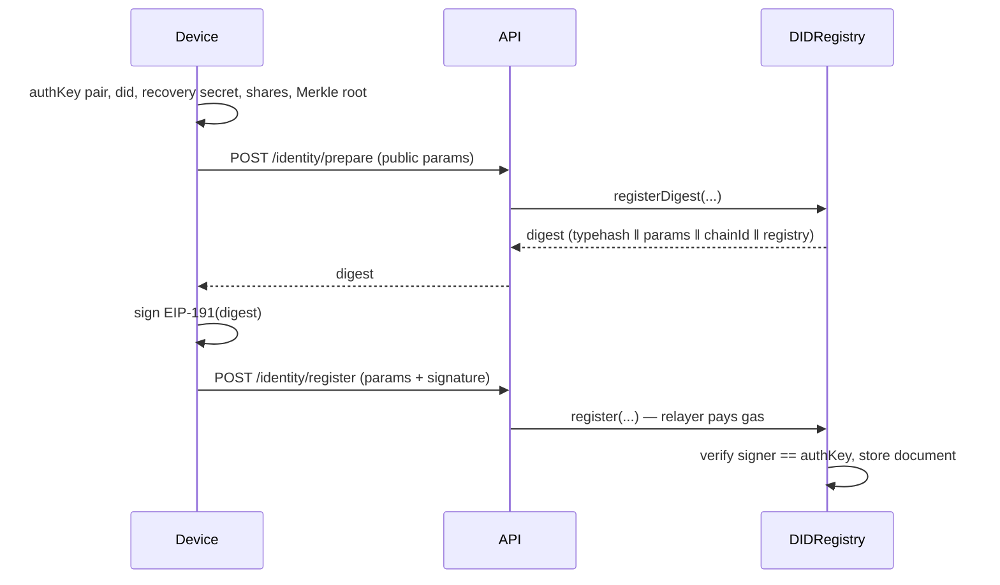

# Architecture

## 1. Scope

The prototype implements the recovery-critical path of a self-sovereign identity system:

1. register a DID whose authentication key is controlled by the user's device,
2. authenticate to multiple applications with that DID,
3. recover the account after the device (and therefore the auth key) is lost, using shares
   of a **separate** recovery secret,
4. keep every step auditable on-chain without publishing secrets or personal data.

Out of scope for this iteration: guardian messaging, DID document standardisation, social
recovery policy, key revocation lists beyond the single auth key, production persistence.

## 2. Components

| Component | Responsibility | Trust boundary |
| --- | --- | --- |
| `apps/web` | key generation, SSS split/combine, sealing, signing, operator UI | user device |
| `packages/crypto` | field arithmetic, commitments, DID identifiers | user device (also used by tests) |
| `services/api` (Python/FastAPI) | challenges, signature verification, chain reads, gas relay, sealed share mailboxes | semi-trusted server |
| `services/api/demo_client` | device-side reference client for tests and the e2e demo | test/demo only |
| `packages/contracts` | DID documents, recovery state machine, events | public chain |
| `infra/besu` | QBFT genesis, four validator keys, network entry point | private chain |
| PostgreSQL | sessions, one-shot challenges, guardian envelopes, relay locks | semi-trusted server |

The backend is deliberately **not** trusted with secrets. It can refuse service or censor a
relay, but it cannot forge a login or a recovery: both require a signature by a key it never
sees.

## 3. Identity model

### Identifier

`did:sss:0x<20 random bytes>` — generated once at registration.

The identifier is **not** derived from the auth key. If it were, rotating the key would change
the DID and break every application binding, which defeats the purpose of recovery. A random
namespace id keeps the identity stable across rotations. The registry key is
`keccak256(utf8(did))`.

### Document

```
DIDDocument {
  authKey      address   // verifies login challenges
  recoveryKey  address   // address of the recovery secret scalar
  shareRoot    bytes32   // Merkle root of share commitments
  threshold    uint8     // k
  shareCount   uint8     // n
  createdAt    uint64
  updatedAt    uint64
  version      uint32    // starts at 1, +1 per rotation
  active       bool
}
```

There is no controller field: authority is always "whoever signs with `authKey`". This keeps
the contract small and removes an admin surface.

### Keys

- **Auth key**: secp256k1 key pair generated on the device. Only the address is public.
- **Recovery secret**: 32 random bytes reduced into `[1, n-1]` over the secp256k1 group
  order. It *is* a private key, so the reconstructed scalar can sign the rotation directly.
  Its address is `recoveryKey`.
- **Shares**: evaluations of a random polynomial of degree `k-1` with constant term = secret.
  Any `k` shares interpolate the secret; any `k-1` leave it uniformly undetermined.

The two secrets are independent. Losing the auth key does not expose the recovery secret;
compromising one share does not expose either.

## 4. Registration



Properties:

- Registration is self-authenticating: only the holder of the auth key can register that key.
- The digest binds `chainId` and the registry address, so a signature cannot be replayed on
  another chain or another deployment.
- The relayer cannot substitute parameters: they are all inside the signed digest.

## 5. Authentication

Challenge payload (EIP-712, domain = `{name, version, chainId, verifyingContract}`):

```
Login { string did, string app, bytes32 nonce, uint64 issuedAt, uint64 expiresAt }
```

Server checks, in order: challenge exists → not consumed → not expired → DID exists and is
active → recovered signer equals `authKey`. Only then is the challenge consumed and a session
token issued. `app` is part of the signed message, so a signature harvested by app A is
useless at app B; `nonce` and `expiresAt` block replay over time.

Sessions are opaque random tokens with a TTL, stored in PostgreSQL together with the
challenges. They are not JWT: rows can be revoked by deleting them, and a second API instance
sees the same sessions, which matters because the deployment is a container behind nginx.

## 6. Recovery state machine

```
        initiateRecovery (permissionless)
                 │
                 ▼
   ┌─────── PENDING (executeAfter = now + delay) ───────┐
   │                                                    │
   │ cancelRecovery(sig by authKey)      executeRecovery(sig by recoveryKey)
   ▼                                                    ▼
CANCELLED                                          EXECUTED
                        (authKey := new, recoveryKey := new,
                         shareRoot := new, version++, shareCount/threshold := new)
```

Why two phases:

- **Permissionless request** is required because the owner may have lost every key. Requiring
  the auth key to open a request would make the worst case unrecoverable.
- **Timelock** gives a user who still has the auth key a window to cancel an attacker's
  request. The prototype uses 30–60 s locally; a deployment would use 24–72 h.
- **Signature-gated execution** is the actual authorisation. Opening a request changes
  nothing.

Replay and duplication:

- one pending request per DID (`RecoveryPending`),
- execution requires `requestId == latest request`,
- `executed` flag blocks a second execution (`NoPendingRecovery`),
- the request commits to the *new* `shareRoot`, so the next recovery starts from a fresh
  secret even if the attacker saw the previous share set.

Signature malleability is handled by rejecting `s > n/2` and non-canonical `v`.

## 7. Shares and commitments

- Each leaf = `keccak256(index ‖ shareValue32)`.
- Root = pairwise `keccak256(min ‖ max)`, duplicating the last node when a level is odd.
- Only the root goes on-chain. Each envelope carries its Merkle proof.
- Before combining, the client verifies every selected share against the root read from the
  chain. A tampered or foreign share is rejected before it can corrupt the interpolation.

### Sealed distribution and random selection

The lecturer's note asked for **randomised sharing**: nobody, including the recovering device,
should be able to say who holds which share.

1. The device splits the secret and builds `n` envelopes (share + Merkle proof).
2. It fetches the guardians' X25519 public keys, shuffles the assignment locally, and seals
   each envelope with an ephemeral key (X25519 + HKDF-SHA256 + ChaCha20-Poly1305). Only
   ciphertext reaches `POST /api/shares/deposit`; the device then drops its plaintext set.
3. During recovery the device generates an ephemeral transport keypair and asks the network
   for `k` shares. The API picks **k guardians at random**, each guardian unseals its own box
   and reseals the payload to the device's transport key.
4. The device opens the boxes, verifies the proofs, reconstructs, signs the rotation.

Consequences: a database dump yields ciphertext; a guardian learns nothing about its own
share without opening it; the device cannot target a specific guardian; and the API cannot
read any share because it never holds a key that opens a box.

The chosen construction is a **commitment**, not encryption: it proves a share belongs to the
committed set without revealing it. Security relies on the 256-bit preimage resistance of
keccak; a share is a uniformly random field element, so guessing is infeasible.

## 8. Threat model

| Adversary capability | Effect | Mitigation |
| --- | --- | --- |
| Steal the auth private key | can log in until rotation | recovery flow revokes the key; audit shows rotation |
| Compromise the server / relayer | can censor, cannot forge | all authority is signature-based; keys never sent |
| Compromise a guardian | holds 1 share | below threshold; cannot reconstruct |
| Compromise `k-1` guardians | nothing about the secret | information-theoretic secrecy of SSS |
| Replay a login signature | none | nonce is single-use and expires; app bound in the message |
| Open a malicious recovery request | none until signed | timelock + auth-key cancellation; execution needs recovery key |
| Replay a rotation signature | none | request id, chain id, registry address, executed flag |
| Read the chain | no secrets | only public keys, root, metadata |
| Front-run registration | griefing only | a DID is self-signed; an impostor cannot register a key they do not hold |

| Read the database | ciphertext, sessions, challenges | sealed boxes; sessions are bearer tokens with a TTL |
| Ask for a specific guardian's share | refused | the API samples guardians server-side |
| Replay a sealed envelope to another device | fails | AAD binds both public keys; transport key is per recovery |
| Submit two relays for one DID | duplicate recovery | `relay_locks` row plus contract guards |

Residual risks (documented, not solved here):

- A compromised *device with the auth key present* can cancel a legitimate recovery. This is
  inherent; the timelock trades attacker-cancellation for owner-cancellation.
- Guardians colluding above the threshold can steal the identity. Threshold selection is a
  social decision.
- The relayer can refuse to submit transactions (censorship) or leak metadata (timing, DID
  usage). A production design needs multiple relayers and/or user-paid gas.
- The demo keeps the pending share set as ciphertext in localStorage so a page reload does
  not lose the request; the plaintext secret is reconstructed only in memory and never
  persisted. A production client would keep the pending set in device secure storage.
- Guardians are services co-located with the API: the custody model is real, the social and
  transport layer is not.

## 9. Data minimisation

On-chain: 20 + 20 + 32 + 2 + ~13 bytes per document, plus one event per action. No name,
email, device id, IP or share. Off-chain: sessions and challenges with TTL, sealed envelopes
(ciphertext only), a row per share request recording *which* guardians served it, and relay
locks. No plaintext share, no secret, no personal data.

## 10. Failure behaviour

- RPC unavailable → API returns a typed error; the UI surfaces the code and keeps state.
- Transaction in flight → per-DID lock returns `409 busy`, preventing double submissions.
- Challenge expired or consumed → `410` / `404` with distinct codes.
- Wrong key, wrong app, wrong request, timelock too early → specific contract custom errors.
- Reconstruction mismatch → the client refuses to sign and reports which check failed.

## 11. Production path

1. Add rate limiting and monitoring; sessions already live in PostgreSQL and can move to a
   shared cache if the load grows.
2. Multi-relayer with per-user quotas; optionally let users pay their own gas.
3. Split the guardian services out of the API process, each with its own key store and
   delivery channel; the sealed-envelope protocol does not change.
4. Replace the custom DID method with `did:ethr`/`did:key` resolution and a W3C document.
5. Contract review: reentrancy is absent (no external calls), but storage layout, upgrade
   strategy and denial-of-service via request spam need review.
6. Add a share-refresh protocol so a leaked share set ages out without changing the identity.

## 12. Why no oracle

The specification reserves an oracle for off-chain integration. This design needs none: the
registry is the source of truth and the backend reads it directly over JSON-RPC. An oracle
would only be needed for cross-chain resolution or external attestations (e.g. verifying a
government ID), which are outside the recovery path.
